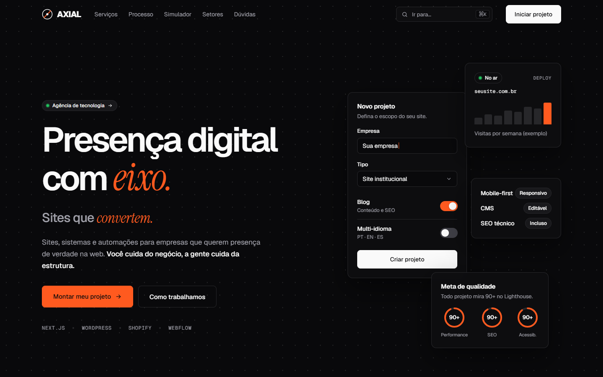
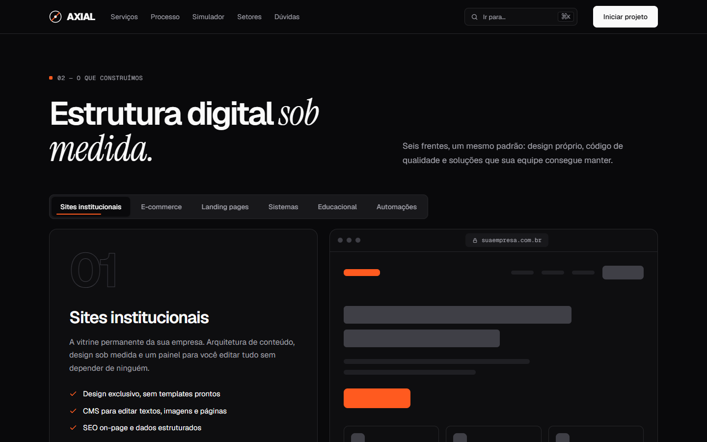
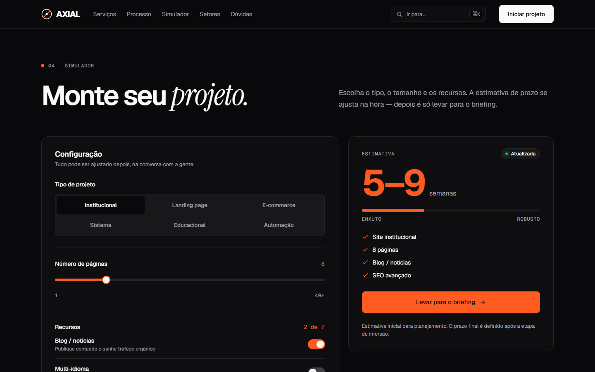
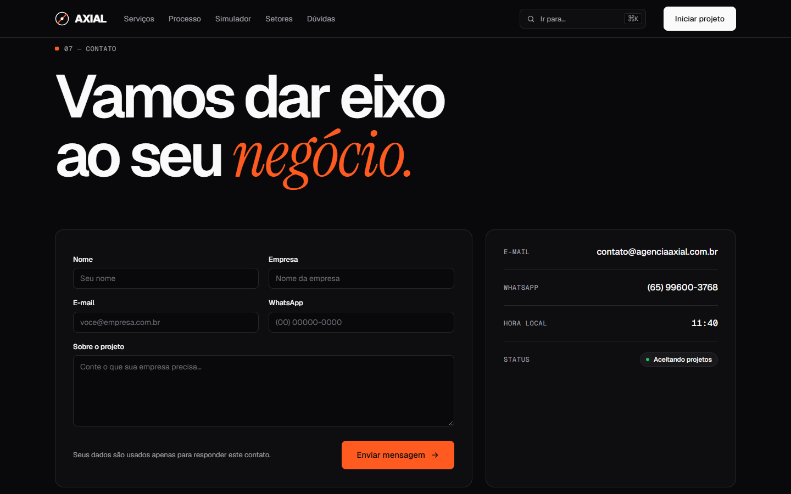
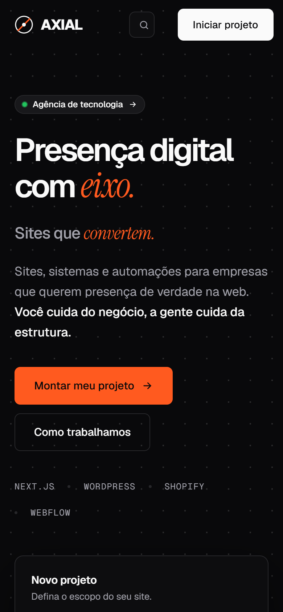
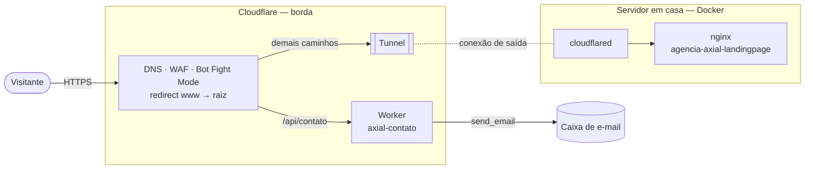

<div align="center">


# AXIAL — agência de tecnologia

**Site institucional da AXIAL, hospedado em servidor próprio e publicado pela borda da Cloudflare.**

[**agenciaaxial.com.br**](https://agenciaaxial.com.br)


<br>



</div>

## Sobre o projeto

Landing page da AXIAL, agência que cria sites, lojas virtuais, sistemas e automações. Além da página,
este repositório mostra **a infraestrutura inteira para colocar um site no ar com custo zero de hospedagem**:

- 🏠 **Servidor próprio**, sem abrir nenhuma porta no roteador: a Cloudflare chega até ele por um *Tunnel*.
- ✉️ **Formulário de contato serverless**, que envia e-mail direto da borda da Cloudflare, sem servidor SMTP.
- 🛡️ **Segurança na borda**: HTTPS automático, WAF bloqueando scanners, Bot Fight Mode e limite de envios.
- 📱 **Responsivo**, com simulador de projeto interativo e modo de movimento reduzido.

## Telas

| Serviços | Simulador de projeto |
|---|---|
|  |  |

| Contato (formulário real) | Mobile |
|---|---|
|  |  |

## Arquitetura



**Por que assim?**

| Decisão | Motivo |
|---|---|
| **Tunnel** em vez de abrir portas | O `cloudflared` conecta *de dentro para fora*: nada entra pelo roteador, funciona atrás de CGNAT e o IP de casa não aparece. |
| Container **sem `ports:`** | O nginx só existe na rede Docker interna. O único caminho até ele é o Tunnel. |
| **Worker** para o formulário | O binding `send_email` entrega para destinos verificados sem conta SMTP nem senha; é grátis e o formulário funciona mesmo se o servidor cair. |
| HTML **sem cache**, assets com cache de 7 dias | Deploy novo aparece na hora, sem sacrificar a velocidade. |

## Formulário de contato

O formulário faz `POST /api/contato` com JSON. O Worker ([`worker/src/index.js`](worker/src/index.js)):

1. aceita apenas requisições com `Origin` do próprio site;
2. descarta robôs pelo *honeypot* (campo invisível que só robô preenche);
3. valida e limita o tamanho dos campos e remove quebras de linha (evita injeção de cabeçalhos como `Bcc:`);
4. monta o e-mail em MIME com UTF-8 e envia, com o e-mail do cliente no `Reply-To`.

Na frente dele, uma regra de *rate limiting* do WAF bloqueia quem passar de 3 envios em 10 segundos.

| Teste | Resposta |
|---|---|
| `GET /api/contato` | `405` |
| `POST` de outro domínio | `403` |
| Campos inválidos | `400` com mensagem em português |
| Envio válido | `200` e e-mail entregue |
| 4º envio seguido do mesmo IP | `429` |

## Estrutura

```
.
├── site/                    # a página: index.html, ícones, imagem de prévia (og-image)
├── nginx.conf               # cabeçalhos de segurança, cache, IP real do visitante
├── docker-compose.prod.yml  # nginx sem portas publicadas, na rede do proxy
├── worker/                  # Cloudflare Worker do formulário (wrangler)
├── logo/                    # logo em SVG/PNG + propostas alternativas
└── docs/img/                # capturas de tela deste README
```

## Rodando localmente

```bash
# site
cd site
python -m http.server 8000          # http://localhost:8000

# formulário (o e-mail vira um arquivo .eml em .wrangler/tmp/email, nada é enviado)
cd worker
npm install
echo "TO=destino@exemplo.com" > .dev.vars
npx wrangler dev
```

## Deploy

**Site**: o `site/` é montado como volume no container, então HTML novo aparece na hora.

```bash
tar czf - docker-compose.prod.yml nginx.conf site | ssh <servidor> \
  'mkdir -p ~/apps/agencia-axial && cd ~/apps/agencia-axial && tar xzf - && docker compose -f docker-compose.prod.yml up -d'
```

**Worker**:

```bash
cd worker
npx wrangler deploy
npx wrangler secret put TO   # destino do e-mail (precisa estar verificado no Email Routing)
```

> **Pegadinha:** os links de e-mail ficam entre `<!--email_off-->…<!--/email_off-->`. Sem isso, o
> *Email Obfuscation* da Cloudflare troca o endereço por `[email protected]` e a página, que é montada
> por JavaScript, não desfaz a troca.

---

<div align="center">
<sub>Feito com eixo. · <a href="https://agenciaaxial.com.br">agenciaaxial.com.br</a></sub>
</div>
